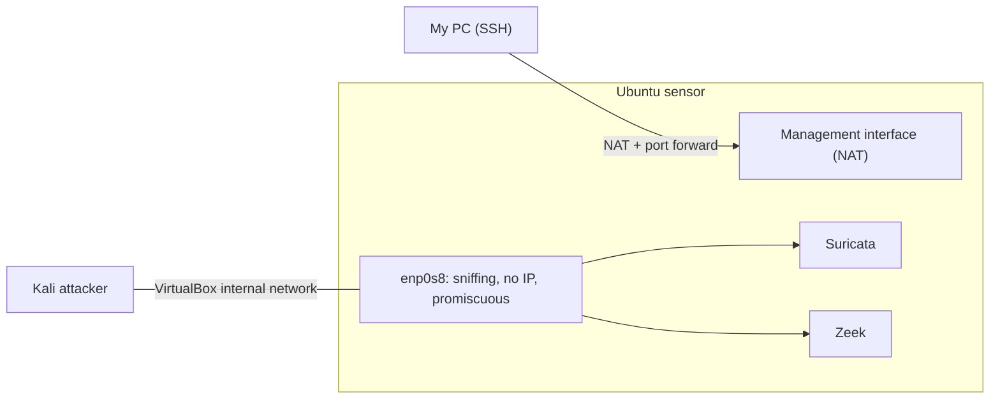
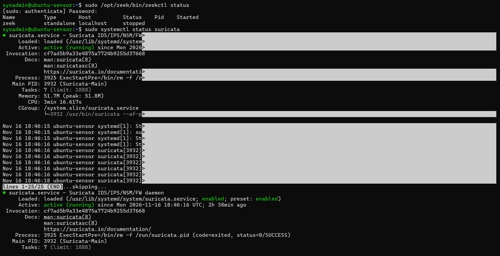
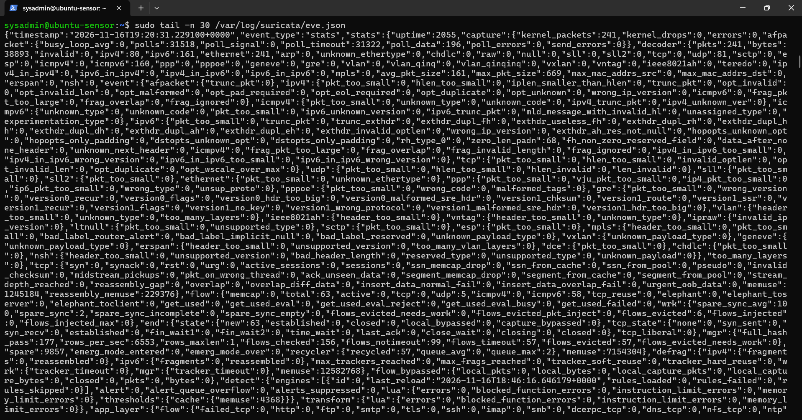
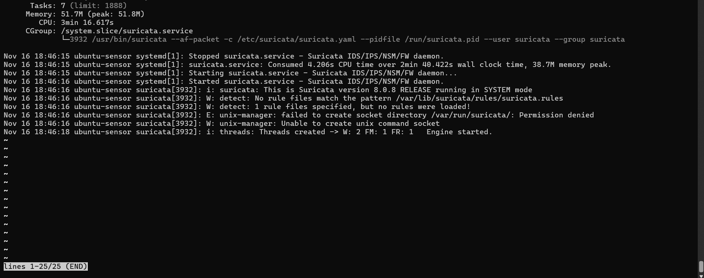

# Network Sensor Deployment: Passive IDS with Suricata and Zeek

A home lab where I built an out-of-band network sensor that passively watches traffic on an isolated network segment, then generated scan traffic from an attacker VM to test detection.

> **Status:** Sensor, sniffing interface, and both IDS engines are installed and configured. Detection verification (alerts and Zeek logs from a live scan) is in progress; see [Verification](#4-verification).

## Skills demonstrated

- Linux server administration (Ubuntu Server 22.04, systemd, Netplan, `ip` tooling)
- Network design: separate management and monitoring interfaces, an IP-less sniffing interface in promiscuous mode
- IDS/NSM deployment: Suricata (signature-based detection) and Zeek (network metadata logging)
- Reading service logs to find and fix configuration problems
- Generating test traffic with Nmap from Kali Linux

## Lab environment

| Component | Details |
|---|---|
| Hypervisor | Oracle VirtualBox |
| Sensor | Ubuntu Server 22.04 LTS |
| Attacker | Kali Linux |
| IDS engines | Suricata 8.0.8, Zeek 9.0.1 |

## Architecture



- **Management interface:** NAT with port forwarding so I can SSH into the sensor.
- **Sniffing interface (`enp0s8`):** no IP address, so the sensor can't be reached or seen on the monitored network; promiscuous mode lets it capture all frames on the segment, not just ones addressed to it.
- VirtualBox's promiscuous mode on an internal network stands in for a switch SPAN (port mirroring) port, which is how a sensor like this would be fed in a real network.

## Build steps

### 1. Sniffing interface
Configured `enp0s8` with Netplan (no IP address) and enabled promiscuous mode.


### 2. Installing the engines
Installed Suricata and Zeek from their official package repositories and added Zeek to the system PATH.


### 3. Binding both engines to the sniffing interface
Edited `/etc/suricata/suricata.yaml` (af-packet interface) and `/opt/zeek/etc/node.cfg` so both engines listen only on `enp0s8`.



### 4. Verification
Suricata starts and captures packets on the sniffing interface (packet counters in `eve.json` stats):



Remaining verification steps:

```bash
# Load the free Emerging Threats ruleset, then restart Suricata
sudo suricata-update
sudo systemctl restart suricata

# Start Zeek
sudo /opt/zeek/bin/zeekctl deploy

# From Kali: SYN scan a target on the monitored segment
sudo nmap -sS <target-ip>

# On the sensor: check for scan alerts and connection logs
sudo tail -n 20 /var/log/suricata/fast.log
sudo tail -n 20 /opt/zeek/logs/current/conn.log
```

<!-- TODO: add screenshots of fast.log scan alerts and Zeek conn.log here once captured -->

## Troubleshooting and lessons learned

- **Suricata was running but couldn't alert.** The service showed `active (running)`, but its startup log said no rule files were loaded. A running IDS with zero rules sees traffic but detects nothing, so "service is up" isn't the same as "detection works." Fix: `suricata-update`, then verify `rules_loaded` is above zero.

  

- **Zeek installed but not started.** `zeekctl status` showed `stopped`; Zeek needs `zeekctl deploy` to install its config and start.
- **Kali had no address on the internal network.** With no DHCP server on the isolated segment, I assigned a static IP manually so Nmap could send traffic.
- **Pasting long repository URLs into the VM console broke them.** I stored the URLs in shell variables first, then used the variables in the install commands.

## Next steps

- Capture Suricata alerts and Zeek logs from a live scan (above)
- Write a custom Suricata rule and trigger it
- Forward logs to a SIEM (e.g. Splunk Free or Elastic) and build a simple dashboard
