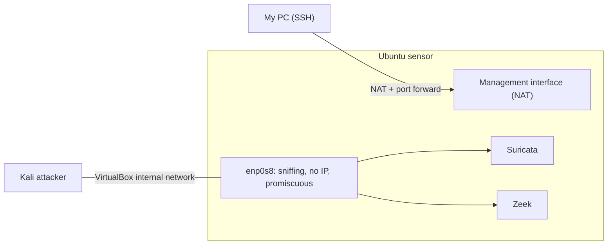
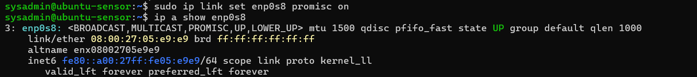
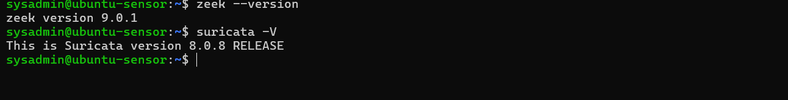
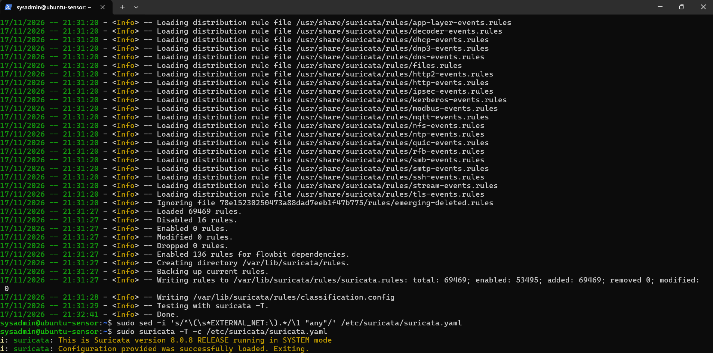
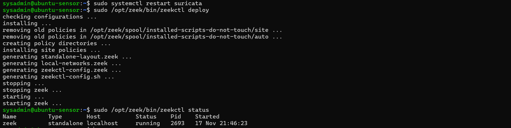
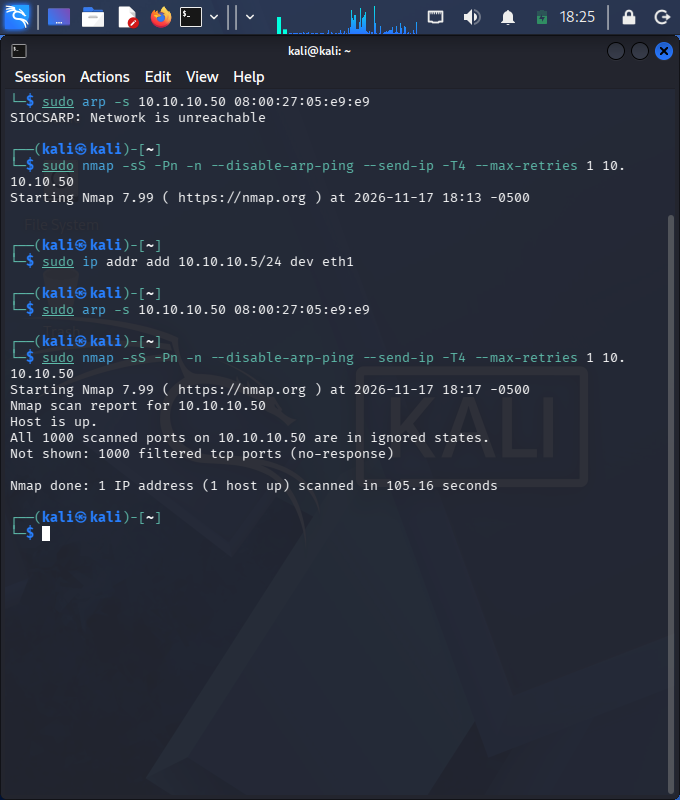
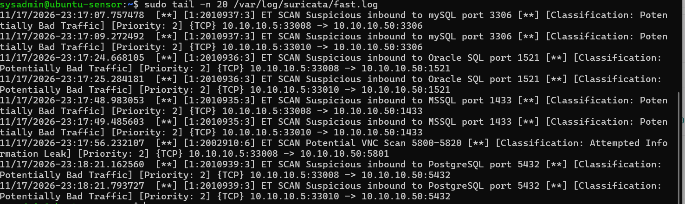
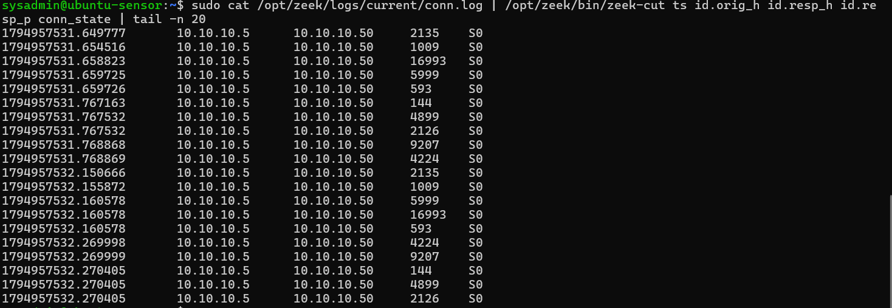
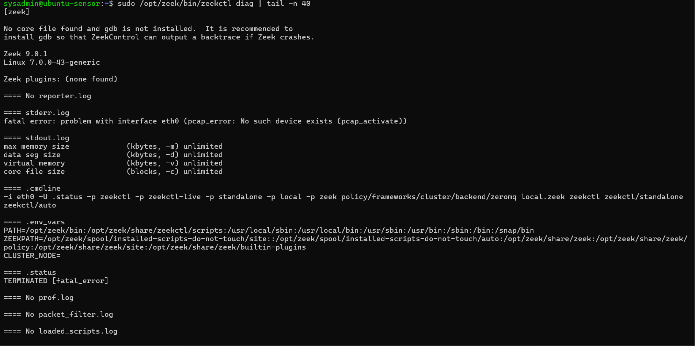

# Network Sensor Deployment: Passive IDS with Suricata and Zeek

A home lab where I built an out-of-band network sensor that passively watches traffic on an isolated network segment, then generated scan traffic from an attacker VM to test detection.

> **Result:** The passive sensor detected an Nmap SYN scan from the attacker VM. Suricata (Emerging Threats ruleset, 53,000+ rules enabled) raised `ET SCAN` alerts for probes to MySQL, Oracle, MSSQL, PostgreSQL, and VNC ports, and Zeek logged the scan as a burst of unanswered (`S0`) connection attempts. See [Verification](#6-verification).

## Skills demonstrated

- Linux server administration (Ubuntu Server 22.04, systemd, Netplan, `ip` tooling)
- Network design: separate management and monitoring interfaces, an IP-less sniffing interface in promiscuous mode
- IDS/NSM deployment: Suricata (signature-based detection) and Zeek (network metadata logging)
- Reading service logs to find and fix configuration problems
- Generating test traffic with Nmap from Kali Linux

## Lab environment

| Component | Details |
|---|---|
| Hypervisor | Oracle VirtualBox |
| Sensor | Ubuntu Server 22.04 LTS |
| Attacker | Kali Linux |
| IDS engines | Suricata 8.0.8, Zeek 9.0.1 |

## Architecture



- **Management interface:** NAT with port forwarding so I can SSH into the sensor.
- **Sniffing interface (`enp0s8`):** no IP address, so the sensor can't be reached or seen on the monitored network; promiscuous mode lets it capture all frames on the segment, not just ones addressed to it.
- VirtualBox's promiscuous mode on an internal network stands in for a switch SPAN (port mirroring) port, which is how a sensor like this would be fed in a real network.

## Build steps

### 1. Sniffing interface
Configured `enp0s8` with Netplan (no IP address) and enabled promiscuous mode.



### 2. Installing the engines
Installed Suricata and Zeek from their official package repositories and added Zeek to the system PATH.



### 3. Binding both engines to the sniffing interface
Set the af-packet interface in `/etc/suricata/suricata.yaml` and `interface=enp0s8` in `/opt/zeek/etc/node.cfg` so both engines listen only on the sniffing interface.

### 4. Loading rules and starting the engines
Pulled the Emerging Threats Open ruleset with `suricata-update` (69,469 rules, 53,495 enabled), set `EXTERNAL_NET` to `any` so lab-internal scans are evaluated by scan rules, and confirmed the config with `suricata -T`.



Restarted Suricata and deployed Zeek; both engines running:



### 5. Attack simulation
Gave Kali's lab interface an address (`10.10.10.5/24`), mapped the target IP `10.10.10.50` to the sensor's sniffing-interface MAC with a static ARP entry, and ran a SYN scan of the top 1,000 ports. The sensor has no IP, so it silently drops the probes (nothing replies, hence "filtered"), but its capture engines see every packet:

```bash
sudo nmap -sS -Pn -n --disable-arp-ping --send-ip -T4 --max-retries 1 10.10.10.50
```



### 6. Verification
Suricata detected the scan within seconds. `fast.log` shows Emerging Threats `ET SCAN` alerts for SYN probes from `10.10.10.5` to commonly targeted database and remote-access ports:

| Signature ID | Alert | Port |
|---|---|---|
| 2010937 | ET SCAN Suspicious inbound to mySQL port 3306 | 3306 |
| 2010936 | ET SCAN Suspicious inbound to Oracle SQL port 1521 | 1521 |
| 2010935 | ET SCAN Suspicious inbound to MSSQL port 1433 | 1433 |
| 2002910 | ET SCAN Potential VNC Scan 5800-5820 | 5801 |
| 2010939 | ET SCAN Suspicious inbound to PostgreSQL port 5432 | 5432 |



```bash
sudo tail -n 20 /var/log/suricata/fast.log
```

Zeek independently recorded the scan in `conn.log`: a burst of connection attempts from `10.10.10.5` to `10.10.10.50` across many ports within the same second, each with state `S0` (SYN sent, no reply). That pattern of many short, unanswered connections to different ports is the signature of a SYN scan, even without a signature-based alert.



```bash
sudo cat /opt/zeek/logs/current/conn.log | /opt/zeek/bin/zeek-cut ts id.orig_h id.resp_h id.resp_p conn_state | tail -n 20
```

## Troubleshooting and lessons learned

- **Suricata was running but couldn't alert.** The service showed `active (running)`, but its startup log said no rule files were loaded. A running IDS with zero rules sees traffic but detects nothing, so "service is up" isn't the same as "detection works." Fix: `suricata-update`, then verify `rules_loaded` is above zero.

  

  The `eve.json` stats from that run confirm it: packets captured, but `rules_loaded: 0` and `alert: 0`.

  

- **Zeek crashed on start.** `zeekctl status` showed `stopped`, and `zeekctl deploy` failed with "terminated immediately." `zeekctl diag` showed the cause: `node.cfg` still had the default `interface=eth0`, which doesn't exist on this sensor. Fixed by setting `interface=enp0s8`.

  

  Earlier service status, before both fixes:

  

- **First scan never reached the lab network.** Kali's lab interface (`eth1`) had no IPv4 address, so the route to the target went out the NAT interface instead. Assigned `10.10.10.5/24` to `eth1` and confirmed with `ip route get`.
- **Nmap ignored the static ARP entry.** On a local subnet Nmap does its own ARP lookup, got no reply, and marked the host down without scanning. `--disable-arp-ping --send-ip` makes it use the kernel's routing and ARP table instead.
- **The sensor saw broadcasts but not the scan.** Zeek logged Kali's IPv6 neighbor discovery and DHCP broadcasts, so both VMs were on the same segment, but none of the unicast SYN probes. The scan was addressed to a MAC that didn't exist on the network, and the hypervisor's virtual switch didn't deliver those frames to the sensor. Mapping the target IP to the sensor's own MAC fixed it; with no IP on the sniffing interface the sensor still never responds. On a physical network the equivalent fix is a SPAN or TAP feeding the sensor a copy of all traffic.
- **Settings don't survive a reboot.** After restarting the VMs, Kali's lab IP and the sensor's promiscuous flag were gone and Zeek needed `zeekctl deploy` again. Making these persistent (Netplan on Kali/sensor, `zeekctl cron` or a systemd unit for Zeek) is on the next-steps list.
- **`sudo` and redirects.** `sudo cmd < file` fails on root-only files because the shell opens the file before `sudo` runs; `sudo cat file | cmd` works.
- **Pasting long repository URLs into the VM console broke them.** I stored the URLs in shell variables first, then used the variables in the install commands.

## Next steps

- Make interface settings and Zeek startup persistent across reboots
- Write a custom Suricata rule and trigger it
- Forward logs to a SIEM (e.g. Splunk Free or Elastic) and build a simple dashboard
